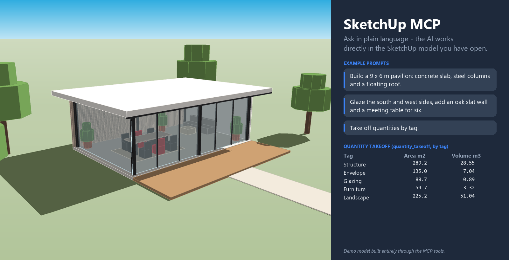
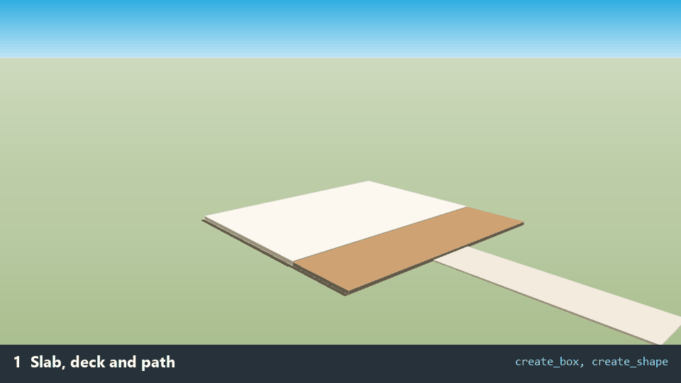

# SketchUp MCP

[English](README.md) | **Tiếng Việt**



SketchUp MCP cho phép Claude làm việc trực tiếp trên mô hình SketchUp đang mở. Bạn hỏi bằng ngôn ngữ tự nhiên (tiếng Việt, tiếng Anh hay ngôn ngữ nào cũng được), Claude sẽ đọc mô hình, bóc khối lượng theo tag hoặc vật liệu, dựng hình, gán vật liệu và tag, chụp ảnh để tự kiểm tra, xuất ảnh và xuất file. Gồm hai phần: một extension cho Claude Desktop (`.mcpb`, chạy bằng Node.js có sẵn trong Claude Desktop) và một plugin Ruby nhỏ cho SketchUp (**SU MCP Bridge**). Không cần cài Python hay Node.js.

Phiên bản 1.2.0 (menu, thông báo và mô tả công cụ bằng tiếng Anh). Bản đầy đủ và cập nhật nhất của tài liệu này là [README.md](README.md) (tiếng Anh).

## Tính năng

26 công cụ, đơn vị chiều dài là mm (diện tích m², thể tích m³, góc theo độ, trục Z hướng lên):

| Nhóm | Công cụ |
|---|---|
| Đọc & thống kê | `ping`, `model_info`, `list_tags`, `list_components`, `list_materials`, `selection_info`, `quantity_takeoff` |
| Dựng hình & chỉnh sửa | `create_box`, `create_shape` (đa giác + pushpull), `create_lines`, `insert_component`, `transform_entities`, `set_material`, `set_tag`, `delete_entities`, `select_entities`, `undo` |
| Góc nhìn, ảnh & file | `set_view`, `screenshot`, `export_png`, `export_file`, `save_model`, `open_model`, `new_model` |
| Chạy Ruby | `run_ruby` |
| Cài đặt | `install_sketchup_bridge` |

- **Bóc khối lượng theo tag hoặc vật liệu**: cả mô hình hoặc chỉ phần đang chọn; tổng diện tích mặt, số mặt, chiều dài cạnh, thể tích khối đặc, số lượng component. Lưu ý `face_area_m2` là tổng MỌI mặt (khối đặc gồm mặt trên, dưới, cạnh), không phải diện tích sàn.
- **Chụp ảnh giữ nguyên góc nhìn**: Claude xem ảnh viewport trực tiếp; nếu chụp ở góc khác (iso, top, front...), camera chỉ đổi tạm và được trả lại góc nhìn của bạn sau khi chụp.
- **`run_ruby` là một bước Undo**: khi không có công cụ phù hợp, Claude chạy code Ruby API; cả đoạn code là một bước Undo, lỗi thì thay đổi dở dang được hủy và thông báo chỉ ra dòng bị lỗi.
- **Mỗi lần sửa mô hình là một bước Undo**, tên `MCP: ...` trong menu Edit của SketchUp.
- **`install_sketchup_bridge`**: Claude tự cài/cập nhật plugin vào thư mục Plugins của mọi bản SketchUp đã từng mở (`dry_run` chỉ báo sẽ làm gì).
- **Mặc định an toàn**: vật liệu đã có giữ nguyên màu trừ khi dùng `update_existing=true`; `delete_entities` chỉ xóa theo id; khi quá thời gian chờ, thông báo cho biết lệnh có thể đã chạy để tránh làm lại gây trùng hình.
- **Menu SketchUp** (*Extensions > SU MCP Bridge*): `Start server`, `Stop server`, `Status`, `Open log file`, `Change port...`.

## Demo



Pavilion demo này được dựng hoàn toàn bằng các tool MCP (`create_box`, `create_shape`, `run_ruby`, `set_material`, `set_tag`), sau đó kiểm tra bằng `screenshot` và `quantity_takeoff` - tổng cộng 82 lần gọi tool.

## Cách hoạt động

```
Claude Desktop
    |  MCP qua stdio
    v
sketchup-mcp-1.2.0.mcpb        MCP server Node.js, chạy bằng Node có sẵn trong Claude Desktop
    |  TCP 127.0.0.1:9876 (chỉ trong máy)
    v
SU MCP Bridge                  plugin Ruby trong SketchUp, tự bật khi mở SketchUp
    |  SketchUp Ruby API
    v
mô hình SketchUp đang mở
```

## Yêu cầu

- **Claude Desktop** (bản hiện hành, có mục *Settings > Extensions*), đã đăng nhập tài khoản Claude.
- **SketchUp 2017 trở lên** (bản desktop), đã chạy thử trên SketchUp 2021 và 2023. Mỗi bản SketchUp phải được mở ít nhất 1 lần trước khi cài plugin.
- **Windows 10/11**: đã chạy thử. **macOS**: chưa chạy thử.
- Chỉ khi build từ mã nguồn: Node.js 18 trở lên và npm.

## Tải về

Tải từ [bản phát hành mới nhất](https://github.com/2ez4gcx/sketchup-mcp/releases/latest):

| File | Là gì |
|---|---|
| `sketchup-mcp-1.2.0.mcpb` | Extension cho Claude Desktop (file chính) |
| `su_mcp-1.2.0.rbz` | Plugin SketchUp (SU MCP Bridge), chỉ cần khi cài tay |
| `SketchUpMCP_v1.2.0.zip` | Trọn bộ: extension, plugin, hướng dẫn (HTML + PDF, tiếng Anh và tiếng Việt), câu lệnh mẫu, changelog, giấy phép |
| `SketchUp-MCP-Guide-1.2.0.pdf` | Riêng hướng dẫn tiếng Anh |

## Cài đặt

1. **Cài extension vào Claude Desktop**: *Settings > Extensions* → kéo thả `sketchup-mcp-1.2.0.mcpb` vào cửa sổ, hoặc *Advanced settings > Install Extension...* rồi chọn file → *Install*. Bản này chưa ký số nên Claude có thể cảnh báo *unsigned*: chỉ cài file lấy từ bản phát hành của dự án hoặc tự build. Bản Claude từ Microsoft Store không mở được file `.mcpb` bằng nhấp đúp, hãy cài qua Settings.
2. **Cài SU MCP Bridge vào SketchUp**: trong chat mới, gõ *"Cài SU MCP Bridge vào SketchUp"* (Claude gọi `install_sketchup_bridge`, bấm *Allow*). Hoặc cài tay: *Extensions > Extension Manager > Install Extension* (SketchUp 2017-2020: *Window > Extension Manager*) → chọn `su_mcp.rbz`. Nếu SketchUp không nạp plugin chưa ký số, chọn *Approve Unidentified Extensions* trong Extension Loading Policy (nếu quy định IT cho phép).
3. **Thoát hẳn SketchUp rồi mở lại**, vào *Extensions > SU MCP Bridge > Status* phải thấy `SU MCP Bridge v1.2.0: RUNNING on 127.0.0.1:9876`. Sau đó gõ "Ping SketchUp" trong Claude.

Tùy chọn trong *Settings > Extensions > SketchUp MCP > Configure*: cổng (mặc định 9876) và thời gian chờ mỗi lệnh (mặc định 120 giây). Đổi cổng thì phải đổi cả trong SketchUp (*Extensions > SU MCP Bridge > Change port...*) và khởi động lại SketchUp. Khi cập nhật, luôn cập nhật **cả hai** phần.

Câu lệnh mẫu: [`mcpb/release-docs/vi/CAU_LENH_MAU.txt`](mcpb/release-docs/vi/CAU_LENH_MAU.txt). Hướng dẫn đầy đủ (HTML và PDF) nằm trong file zip của bản phát hành (`vi/HUONG_DAN_SU_DUNG.html` / `.pdf`); mã nguồn: [`mcpb/release-docs/vi/HUONG_DAN_SU_DUNG.html`](mcpb/release-docs/vi/HUONG_DAN_SU_DUNG.html).

## Ứng dụng AI khác (MCP client)

Cài một chạm bằng file `.mcpb` chỉ có trên Claude Desktop. Server là MCP chuẩn (stdio) nên ứng dụng nào chạy được MCP server trên máy đều dùng được, nhưng cần cài **Node.js 18+**.

1. Giải nén file `.mcpb` (thực chất là file zip): `mkdir C:\Tools\sketchup-mcp` rồi `tar -xf sketchup-mcp-1.2.0.mcpb -C C:\Tools\sketchup-mcp` (chạy trong Command Prompt/PowerShell, không dùng Git Bash; hoặc đổi đuôi file thành `.zip` rồi *Extract All*). Server nằm ở `C:/Tools/sketchup-mcp/server/index.mjs`.
2. Khai báo server trong ứng dụng (lệnh `node`, đối số là đường dẫn trên). Cấu hình mẫu cho từng ứng dụng: xem mục **Other MCP clients** trong [README.md](README.md#other-mcp-clients).
3. Cài bridge vào SketchUp như bước 2–3 ở trên, rồi khởi động lại SketchUp.

| Ứng dụng | Trạng thái |
|---|---|
| Claude Desktop | Đã test |
| Claude Code | Đã test (gọi tool, model nhìn thấy ảnh screenshot) |
| Cursor, VS Code (Copilot), Windsurf/Devin Desktop, Codex CLI, ChatGPT desktop (chế độ Codex), Gemini CLI | Cấu hình theo tài liệu chính thức, chưa test |
| ChatGPT bản web | **Không hỗ trợ** (chỉ kết nối MCP server từ xa qua internet) |

Biến môi trường tùy chọn: `SKETCHUP_MCP_PORT` (mặc định 9876) và `SKETCHUP_MCP_TIMEOUT` (giây mỗi lệnh, mặc định 120); nếu ứng dụng có giới hạn thời gian riêng cho mỗi tool, đặt lớn hơn `SKETCHUP_MCP_TIMEOUT`.

Screenshot cần model đọc được ảnh. Nếu máy đã có một SketchUp MCP server khác tên `sketchup`, đặt tên khác cho server này (vd `sketchup-node`) để không bị trùng tool.

## Lưu ý an toàn

- **Chỉ trong máy**: bridge chỉ nghe trên `127.0.0.1`, máy khác trong mạng không kết nối được. Socket không có xác thực, nên chương trình khác chạy trên cùng máy vẫn gửi lệnh được khi bridge đang bật; muốn tắt trong phiên làm việc này, dùng *Extensions > SU MCP Bridge > Stop server* (lần mở SketchUp sau sẽ tự bật lại).
- **Giữ chế độ hỏi xin phép**: không chọn "Always allow" cho `run_ruby`, `delete_entities`, `undo`, `save_model`, `open_model`, `new_model`, `export_file`, `export_png`.
- **`run_ruby` chạy code Ruby bất kỳ** trong SketchUp, không giới hạn thời gian. Đọc kỹ code trước khi cho phép; vòng lặp vô hạn sẽ làm SketchUp đứng và phải đóng bằng Task Manager.
- **Mỗi lần sửa là một bước Undo**: sai thì <kbd>Ctrl</kbd>+<kbd>Z</kbd> hoặc nhờ Claude undo.
- **Làm việc trên bản sao** của file dự án; `save_model` không có đường dẫn sẽ ghi đè file hiện tại.
- **Dữ liệu mô hình được gửi cho Claude**: khi bạn hỏi, Claude đọc thông tin mô hình (tên đối tượng, khối lượng, ảnh chụp...) và gửi lên dịch vụ Claude của Anthropic để xử lý. Tuân thủ quy định của tổ chức và khách hàng với dự án cần bảo mật.
- **File log** (*Extensions > SU MCP Bridge > Open log file*) ghi tên lệnh, thời gian và thông báo lỗi, không ghi hình học hay toàn bộ code; nhưng thông báo lỗi có thể trích một phần code `run_ruby`, tên file hoặc tên đối tượng, hãy xem lại trước khi gửi cho người khác.

## Xử lý lỗi thường gặp

| Thông báo (trích nguyên văn) | Nguyên nhân | Cách xử lý |
|---|---|---|
| `Cannot connect to SketchUp at 127.0.0.1:9876. ...` | SketchUp chưa mở, plugin chưa cài hoặc đang tắt. | Mở SketchUp, xem *Status*; chưa có menu *SU MCP Bridge* thì làm lại bước 2; báo `STOPPED` thì bấm *Start server*. |
| `SketchUp did not respond within 120s (command '...'). ... MAY HAVE ALREADY RUN` | Lệnh sửa mô hình chạy quá thời gian chờ, có thể đã chạy xong. | Đừng làm lại ngay. Kiểm tra mô hình, bị trùng thì undo (sau `save_model`, `open_model`, `new_model`, `export_*` hoặc chính `undo` thì kiểm tra file/mô hình, đừng undo). Tăng Timeout trong *Configure* (ứng dụng khác: `SKETCHUP_MCP_TIMEOUT`). |
| `SketchUp did not respond within 120s (command '...'). This command does not modify the model and can be retried` | Lệnh đọc (vd bóc khối lượng mô hình lớn) chưa xong. | Tăng Timeout trước (*Configure*, hoặc `SKETCHUP_MCP_TIMEOUT` ở ứng dụng khác), đợi SketchUp hết bận rồi hỏi lại. |
| `Unsupported command: ...` hoặc `ping` có dòng `warning` | Plugin trong SketchUp cũ hơn extension. | Chạy lại `install_sketchup_bridge`, thoát hẳn và mở lại SketchUp. |
| `Port 9876 is used by another SketchUp window (or another program).` | Đang mở 2 cửa sổ SketchUp. | Đóng cửa sổ kia, bấm *Extensions > SU MCP Bridge > Start server*. |
| `Windows does not allow port 9876 ...` | Cổng nằm trong dải Windows/Hyper-V giữ riêng. | *Extensions > SU MCP Bridge > Change port...*, khởi động lại SketchUp, đặt cùng cổng trong *Configure* (ứng dụng khác: `SKETCHUP_MCP_PORT`). |
| `run_ruby must not call exit/abort (SystemExit) - changes were rolled back` | Code Ruby gọi `exit`/`abort`. | Thay đổi đã được hủy; yêu cầu Claude viết lại không dùng `exit`. |
| `Command '...' HAS RUN in SketchUp but its result could not be sent ...` | Lệnh đã chạy nhưng không gửi được kết quả. | Đừng chạy lại; nhờ Claude kiểm tra bằng `model_info`/`selection_info`. |
| `No SketchUp version that has been opened at least once was found on this machine.` | Chưa tìm thấy thư mục người dùng của SketchUp. | Mở SketchUp một lần rồi đóng, sau đó cài lại, hoặc cài tay `su_mcp.rbz`. |
| Mỗi công cụ SketchUp xuất hiện 2 lần | Còn cấu hình SketchUp MCP cũ (vd mục `"sketchup"`) trong `claude_desktop_config.json`. | Xóa mục đó (*Settings > Developer > Edit Config*) rồi khởi động lại Claude Desktop. |

## Build từ mã nguồn

```bash
cd mcpb
npm install
npm run build     # esbuild + tạo su_mcp.rbz từ ../extension + đóng gói dist/sketchup-mcp-<version>.mcpb
npm test          # smoke test + unit test với bridge giả lập (không cần SketchUp)
npm run release   # build + unit test + ../release/SketchUpMCP_v<version>/ và file .zip (bản PDF cần Microsoft Edge)
```

Phiên bản phải trùng ở 4 chỗ (`mcpb/package.json`, `mcpb/manifest.json`, `extension/su_mcp/main.rb`, `extension/su_mcp.rb`); bridge Ruby giữ cú pháp Ruby 2.2 để chạy trên SketchUp 2017 trở lên. Chi tiết xem [README.md](README.md#build-from-source).

## Cấu trúc thư mục

- `extension/`: bridge Ruby (SU MCP Bridge): `su_mcp.rb` (loader), `su_mcp/main.rb` (server TCP, lệnh, menu, log).
- `mcpb/`: MCP server Node.js đóng gói thành extension Claude Desktop: `src/index.mjs`, `manifest.json`, `scripts/` (build, test, release), `release-docs/en` và `release-docs/vi` (hướng dẫn và câu lệnh mẫu).
- `.github/workflows/ci.yml`: build và test trên Windows.

## Ghi công

Một số ý tưởng tham khảo từ [zinin/sketchup-mcp2](https://github.com/zinin/sketchup-mcp2) (MIT); không sao chép mã nguồn. Thư viện bên thứ ba đóng gói trong server được liệt kê trong `THIRD_PARTY_NOTICES.txt` (tạo ra khi build).

SketchUp là thương hiệu của Trimble Inc., Claude là thương hiệu của Anthropic. Dự án này không liên kết và không được hai công ty bảo trợ.

## Giấy phép

Phát hành theo [giấy phép MIT](LICENSE). Copyright (c) 2026 Khuong Doan.
